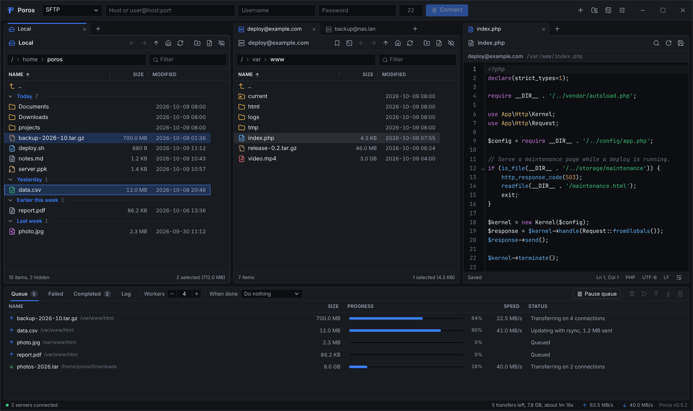

<p align="center">
  
</p>

<h1 align="center">Poros</h1>

<p align="center">
  A fast, keyboard-friendly SFTP, FTP, WebDAV and cloud storage client for Linux and Windows.
</p>

<p align="center">
  <a href="https://github.com/khaodius/poros/actions/workflows/ci.yml"></a>
  <a href="LICENSE"></a>
</p>


## Features

- **Protocols**: SFTP, FTP, FTPS with explicit or implicit TLS, WebDAV over HTTP or HTTPS, Amazon
  S3 and S3-compatible services (any endpoint and region), Backblaze B2, Google Drive, OneDrive
  and Box.
- **Server-to-server copies** by dragging files from one server tab onto another. Two FTP servers
  send files straight to each other (FXP) when both allow it.
- **Drag files out** of any tab into Windows Explorer, the desktop, GNOME Files, Dolphin or any
  other file manager. Files on a server download as you drag, and files dropped on Dolphin or the
  KDE desktop download straight into the folder they were dropped in.
- **Tabs and docking**: local folders, server sessions, editors and terminals are tabs that can be
  merged, split, resized, detached into their own windows and dragged from one window into another.
- **Parallel transfers**: each worker uses its own connection, large files are split across
  idle connections, and the worker count can change while transfers run.
- **File operations**: new files and folders on any server or this computer. Cut, copy and
  paste, Move to and Copy to, and dragging onto a folder (hold Ctrl to copy) move and copy files
  within a server or this computer without a transfer. Properties changes permissions, owner and
  group. Deleting on an SFTP server runs `rm` on the server when its shell allows it, and shows
  how many entries are gone, the one being deleted and any that could not be.
- **File compare** of any two files, side by side with changed words highlighted.
- **Built-in editor** for text files up to 16 MiB, local or on any server, with syntax highlighting
  and find and replace. Each save uploads the file and warns first if it changed on the server.
- **SSH terminal** in a tab for any SFTP connection. Programs on the server that copy through the
  terminal (OSC 52), such as tmux, copy to this computer's clipboard.
- **Folder sync** one way or both ways with rsync's options, set as defaults, per site and per
  run, or typed as rsync arguments, with a preview of every change and the command line the
  options amount to. See [Folder synchronization](#folder-synchronization).
- **rsync delta transfers** over Poros's own SSH connection, with nothing to install locally.
- **Integrity checks, all on by default**: files are written under a temporary name, flushed to
  disk, compared with the source by SHA-256 and only then renamed into place. Servers hash their
  copy with their own `sha256sum`, part by part where GNU `split` allows, so a damaged part is
  sent again on its own; servers without one are read back. A source that changes while it is
  read starts over, resumed files are compared part by part before they continue, times and
  permissions are read back, and downloads are checked against `SHA256SUMS`-style files,
  minisign signatures and, through `gpg`, OpenPGP signatures published beside them. See
  [Integrity checks](#integrity-checks).
- **Automatic recovery**: transfers wait out a dropped connection for up to 10 minutes and resume
  where they stopped, ones that waited longer try again once Poros reaches the server again, server
  tabs reconnect on their own, and unfinished transfers come back paused after a restart.
- **Scheduled tasks** synchronize folders or run a server command once, every few minutes, hours
  or days, or at a time of day on chosen weekdays. Tasks run while Poros is open, and a run missed
  while it was closed happens once at the next start.
- **When the queue finishes**, Poros can close, lock, sleep, hibernate, log off or shut down after a
  countdown, run a local command, show a notification or play a sound.
- **Server commands** from the right-click menu, with the selected files filled in and the output
  streamed into a window.
- **Proxies and jump hosts**: SOCKS5, SOCKS4/4a and HTTP CONNECT proxies, and chains of saved
  connections used as jump hosts, like `ProxyJump` in OpenSSH.
- **Authentication** with OpenSSH, PEM, PKCS#8 and PuTTY `.ppk` (v2, v3) keys, SSH agents,
  Pageant, password and keyboard-interactive login.
- **Host key verification** against your existing `~/.ssh/known_hosts`, which Poros never modifies.
  FTPS, WebDAV and S3 certificates the system does not trust get the same approval prompt, by
  fingerprint.
- **Saved connections**, with passwords and cloud sign-ins stored only on request and only in the
  system keychain. Sites saved in FileZilla, WinSCP, SmartFTP, Cyberduck, PuTTY, KiTTY,
  MobaXterm, the OpenSSH config, and GNOME Files or KDE Dolphin bookmarks can be imported, with
  their folders, jump hosts and the passwords FileZilla and WinSCP keep.
- **Themes** as shareable JSON files, ten built in, with every color editable in settings. File
  lists can show the system's own file icons, Windows Explorer's or your Linux icon theme's, and
  scrolling with the mouse wheel can glide.
- **Progress bars** to taste: solid, gradient, striped, segmented or glowing fills, the theme's
  color, upload and download colors or your own, any thickness, moving stripes, a shimmer or a
  pulse while work runs, and the percent, size or time left beside or on each transfer's bar.
- **Flying files**, off until you want them: files you send, move or copy hop across the window as
  a pile of their own icons and land where they go.
- **Date groups** like Windows Explorer's: local files sit under Today, Yesterday, Earlier this
  week and so on, each group collapsible, with a switch in Settings > Appearance for local and
  server lists.
- **Command line**: `poros-cli` browses, transfers, verifies and synchronizes files without a
  window, for scripts, CI jobs and AI agents, with JSON output and exit statuses to branch on. See
  [Command line](#command-line).
- **Signed updates**: Poros checks for a new release at start-up, downloads it in the background
  and installs it only after verifying its signature, then lets you choose when to restart.
  Settings > Updates turns the check off, and can install an earlier release the same way.



## Folder synchronization

Synchronize folders, on the toolbar or in either pane's right-click menu, compares a local folder
with a folder on an SFTP server and shows every change before it runs. Its options are rsync's, grouped as rsync's manual
groups them, each with the flag it stands for:

- **Which files are copied**: compare by size and time, `--size-only`, `-c` or `-I`;
  `--modify-window`, `-u`, `--ignore-existing`, `--existing`, `--min-size`, `--max-size`.
- **Transfer behaviour**: `-r`, `-d`, `--mkpath`, `-m`, `-W`, `--inplace`, `--append`,
  `--append-verify`, `-B`, `--remove-source-files`, `--fsync`, `--rsync-path`.
- **Deletion**: `--delete` with `--delete-before`, `-during`, `-delay` or `-after`,
  `--delete-excluded`, `--max-delete`, `--force`, `--ignore-errors`.
- **Filter rules**: `--exclude`, `--include`, `--filter` with merge and per-folder rule files,
  `--exclude-from`, `--include-from`, `--files-from`, `-0`, `-F`, `-C`. Protect rules (`P`)
  keep files from deletion.
- **Times, permissions and ownership**: `-t`, `-O`, `-p`, `-E`, `--chmod`, `-o`, `-g`,
  `--chown`, `--numeric-ids`. Owners and groups are matched by name between the two sides.
- **Symbolic links**: `-L`, `-l`, `--safe-links`, `--copy-unsafe-links`, `-k`, `-K`.
- **Bandwidth and compression**: `--bwlimit`, shared by every file of a run, and `-z`.
- **Backups**: `-b`, `--backup-dir`, `--suffix`, for files replaced or deleted.
- **Dry run and reporting**: `-n`, `-i`, `-v`, `--stats`, `--log-file`.

Each run starts from the defaults in Settings > Sync, then the rsync arguments saved with the
site (in the connection's settings, which also take the rsync command for that server), then
whatever is changed in the dialog. Every layer takes arguments typed as on rsync's command line,
such as `-av --delete --exclude=.git/`; combined short flags, `--no-` forms and the archive
flag `-a` work as they do in rsync. A scheduled synchronization keeps the options it was saved
with.

Arguments that make no sense over Poros's own SSH connection are noted and passed over, such as
`-e`, `--partial-dir`, `--sparse`, `-H`, `-A` and `-X`. A few are refused with the reason:
`-R`, `--compare-dest`, `--copy-dest`, `--link-dest`, batch files and time limits.

## Command line

`poros-cli` does what the app does with servers, without a window. Each run connects once, does
one thing and disconnects, and it never prompts: sign-in comes from flags, environment variables
or saved connections, and an unknown host key stops the run until it is accepted. Transfers use
the app's parallel workers, segmented large files, delta copies and checksum verification.

```sh
export POROS_CONNECTION=deploy@example.com      # a saved connection, user@host or sftp://user@host:2222/srv
export POROS_PASSWORD=...                       # or -i ~/.ssh/id_ed25519, or the SSH agent
poros-cli --trust-new-host --save-host-key info # first contact: accept and remember the host key
poros-cli ls -l /srv/www
poros-cli put -w 8 ./site /srv/www
poros-cli sync -d up --delete --exclude '*.tmp' ./site /srv/www/site
poros-cli verify ./site /srv/www/site           # exit status 11 when anything differs
poros-cli exec -- systemctl reload nginx        # exits with the command's own status
```

| Command                   | Does                                                          |
| ------------------------- | ------------------------------------------------------------- |
| `info`, `connections`     | Show the session; list the connections saved in Poros         |
| `ls`, `stat`, `du`        | List folders (`-l`, `-R`, `-a`), show paths, count contents   |
| `cat`, `write`            | Print files (`--offset`, `--length`); write standard input    |
| `get`, `put`              | Download and upload files and folders, `cp`-style placement   |
| `mkdir`, `rm`, `mv`, `cp` | Change files on the server, with globs in the last component  |
| `chmod`, `chown`          | Octal or symbolic modes (`u+x,go-w`), owners and groups, `-R` |
| `checksum`, `verify`      | Hash on the server; compare a local and a server copy         |
| `sync`                    | rsync-style synchronization, `-d up`, `down` or `both`        |
| `exec`                    | Run a command through the server's shell                      |
| `batch`                   | Many commands over one connection, one JSON line each         |

`poros-cli help COMMAND` lists each command's options. Transfers take `-w` workers, `--exists
overwrite|skip|newer|different|resume|rename`, `--verify`, `--limit-up` and `--limit-down`;
`sync` takes `--include`, `--exclude`, `--checksum`, `--dry-run`, `--conflict local|remote` and
any rsync option after `--`, read as the app reads them.

**Connections.** `-c` (`POROS_CONNECTION`) takes a connection saved in Poros by name or id,
`user@host[:port]`, or an address: `sftp://`, `ftp://`, `ftpes://` (explicit TLS), `ftps://`
(implicit TLS), `dav://`, `davs://`, `s3://ACCESS_KEY_ID@endpoint/bucket` or `b2://KEY_ID@`. A
saved connection keeps its settings, proxy and jump hosts, and its password or cloud sign-in from
the system keychain unless `--no-keychain` is given. Otherwise the password comes from
`POROS_PASSWORD`, `--password-env`, `--password-file` or `--password-stdin`, a key from `-i`
(`POROS_IDENTITY`) with its passphrase in `POROS_PASSPHRASE`, `--passphrase-env` or
`--passphrase-file`, or the agent with `--agent`. With none of them, SFTP tries the agent and then
`~/.ssh/id_ed25519`, `id_ecdsa` and `id_rsa`.

**Host keys.** Keys are checked against the ones Poros trusts and `~/.ssh/known_hosts`. An
unknown key exits with status 5 and a changed one with 6, both with the fingerprint.
`--host-key SHA256:...` (`POROS_HOST_KEY`) accepts that key for the run, `--trust-new-host`
accepts a host seen for the first time but never a changed key, and `--save-host-key` remembers
what was accepted. Certificates of FTPS, WebDAV and S3 servers work the same way.

**JSON.** `--json` (`POROS_JSON=1`) prints one JSON document on standard output, errors included:
`{"error": {"kind", "message", "path", "hostKey", "exitCode", "hint"}}`. A command given one path
answers with an object and several with an array. `--progress json` reports transfers on standard
error as one JSON object a second; `--progress text` draws a progress line.

**Batch.** `batch` reads one command per line of standard input, as a JSON array of arguments or
an object with `args`, an `id` to echo, and `input` or `inputBase64` for `write`, and answers
each with one JSON line, in order:

```sh
printf '%s\n' '["mkdir", "-p", "/srv/app"]' \
  '{"id": "env", "args": ["write", "/srv/app/.env"], "input": "MODE=production\n"}' \
  '["stat", "/srv/app/.env"]' | poros-cli batch
```

**Exit status.**

| Status | Meaning                                                  |
| -----: | -------------------------------------------------------- |
|      0 | Success                                                  |
|      1 | Failure without a status of its own                      |
|      2 | Invalid arguments                                        |
|      3 | Could not connect, or the connection dropped             |
|      4 | Sign-in refused, or no password, key or passphrase given |
|      5 | Host key or certificate not trusted yet                  |
|      6 | Host key or certificate changed since it was trusted     |
|      7 | Not found                                                |
|      8 | Permission denied                                        |
|      9 | Already exists                                           |
|     10 | Some items failed (transfers, deletes, synchronization)  |
|     11 | Contents differ, or a file failed its integrity check    |
|     12 | Not supported by the connection's protocol               |
|    130 | Interrupted                                              |

`exec` exits with the status of the command it ran, 128 plus the signal's number for one ended by
a signal. `poros-cli` reads the app's settings, saved connections and trusted host keys from its
config folder (`--config-dir` or `POROS_CONFIG_DIR` picks another, `--default-settings` ignores
the saved settings) and writes nothing there except a host key it is told to remember and a cloud
sign-in the provider renewed.

**Without the app.** In `src-tauri`, `cargo build --release --no-default-features --features cli
--bin poros-cli` builds it without the web view, GTK or the Windows shell, for servers and
containers that have none of them; on Linux it links only the C library.

## Performance

3,600 files totaling 1.4 GiB (3,000 of 16 to 256 KiB, 560 of 1 MiB, 40 of 12 MiB), median of
three runs over a 1 Gbit/s link:

| Client                     | Upload | Download |
| -------------------------- | -----: | -------: |
| Poros, 1 worker            | 20.3 s |   26.2 s |
| Poros, 4 workers (default) | 14.1 s |   15.5 s |
| Poros, 8 workers           | 13.5 s |   13.3 s |
| OpenSSH sftp 9.6           | 17.6 s |   17.9 s |
| rsync 3.2.7                | 13.6 s |   13.7 s |

At 8 workers Poros sustains about 900 Mbit/s, 95% of the link's measured TCP throughput. These
times are from before the integrity checks were on by default; what they cost now is measured
under [Integrity checks](#integrity-checks).

Setup: Poros 0.2.0 release build and a stock OpenSSH 9.6 server on Ubuntu 24.04, in separate
network namespaces joined by a link capped at 1 Gbit/s (941 Mbit/s measured with iperf3, no added
latency), files on RAM disks, 4-core Xeon at 2.1 GHz. To reproduce, run
`POROS_TEST_SSH_PORT=2222 cargo run --release --example transfer_benchmark` in `src-tauri`
against a server set up as for the end-to-end tests.

On a real connection, gigabit at both ends, Poros moved 3,643 files (1.4 GiB) in 16.6 s, about
720 Mbit/s.

## Integrity checks

Every check is on by default, and each can be turned off under Settings > Transfers > Integrity.

- **Temporary name, then rename**: a file is written as `.name.poros-part` beside its target and
  renamed into place only once it is complete and checked, so a partial or failed copy never sits
  under the real name. FTP uploads are written in place.
- **Flush to disk**: the server, through OpenSSH's `fsync@openssh.com`, stores each upload, and
  this computer each download and the folder entry its rename makes, before the file counts as
  done.
- **SHA-256 of both copies**: once a file is complete, the server hashes its copy with its own
  `sha256sum`, or `sha512sum` where that is all it has, and Poros hashes the other copy. SHA-1
  and MD5 are never used: they catch accidents but can be forged.
- **Part by part, with repair**: where the server has GNU `split`, files of 4 MiB and more are
  hashed in up to 64 parts. When no more than half the parts differ, only those are sent again
  and the file is compared once more; otherwise it starts over.
- **Read back**: SFTP servers without a checksum command, such as ones that allow SFTP alone, and
  FTP and WebDAV servers have each finished file read back and hashed here, which doubles the
  traffic with them. Cloud storage is not read back.
- **Resume check**: before an interrupted file continues, the part already transferred is
  compared with the source part by part, and the transfer goes on from the first part that
  differs.
- **Source stability**: a local source is compared before and after it is sent and hashed, by
  size, time to the nanosecond and, on Linux, inode and status change time; a source on a server
  by size and time. A source that changed starts over.
- **Times and permissions** are read back once a file is in place, and any the server or file
  system did not keep are noted in the log.
- **Published checksums and signatures**: downloads are compared with `SHA256SUMS`,
  `SHA512SUMS`, `name.sha256` and similar files beside them, with minisign `.minisig` signatures
  by the keys under Trusted minisign keys and, through `gpg` where it is installed, with `.asc`
  and `.sig` signatures by keys in its keyring. A file that fails is not saved.
- **rsync results**, which rsync checks with MD5, are compared by SHA-256 as well.

### What the checks cost

The [Performance](#performance) workload, 3,600 files totaling 1.4 GiB, most of them small, with
4 workers. Medians of three runs, page cache dropped before each:

| Checks                                         | 1 ms link, upload | 1 ms link, download |  Loopback, upload | Loopback, download |
| ---------------------------------------------- | ----------------: | ------------------: | ----------------: | -----------------: |
| Poros 0.5.5 defaults                           |            30.1 s |              25.7 s |            4.55 s |             3.99 s |
| All off                                        |            29.8 s |              25.4 s |            4.60 s |             4.12 s |
| Flush to disk only                             |      30.8 s (+3%) |        26.8 s (+6%) |     5.77 s (+25%) |      5.67 s (+38%) |
| Checksums only, by the server's `sha256sum`    |     36.0 s (+21%) |       31.5 s (+24%) |     7.68 s (+67%) |      7.18 s (+74%) |
| **All on (default)**                           | **37.0 s (+24%)** |   **33.3 s (+31%)** | **8.91 s (+94%)** | **9.01 s (+119%)** |
| All on, server without `sha256sum` (read back) |     50.1 s (+68%) |       47.9 s (+89%) |    9.41 s (+105%) |     8.71 s (+111%) |

Percentages are against all off. Most of the cost is per file: each file's checksum takes a round
trip to the server and a `sha256sum` started there, so it weighs most on many small files and
on links with more latency, and least on large files. Reading back costs a second pass over the
network instead. On loopback, Poros and the server share the same four cores, so the checks
there show their processing cost rather than what a real server adds.

Setup: Poros 0.5.7 release build and OpenSSH 9.6 on Ubuntu 24.04, both on one 4-core Xeon at
2.3 GHz with ext4 storage. The 1 ms link is a relay on the same machine that adds 1 ms each way
and caps it at 1 Gbit/s; the relay itself holds throughput to 400 to 480 Mbit/s, so those times
compare with each other, not with the table above. The read-back row signs in as a user the
server limits to SFTP. To reproduce, run
`POROS_TEST_SSH_PORT=2222 POROS_BENCH_WORKERS=4 POROS_BENCH_RUNS=3 POROS_BENCH_CHECKS=default cargo run --release --example transfer_benchmark`
in `src-tauri`, with `POROS_BENCH_CHECKS` set to `off`, `checksums` or `flush` for the other
rows, and `POROS_BENCH_DROP_CACHES=1` as root to drop the page cache.

## Install

Windows, in PowerShell:

```powershell
irm https://raw.githubusercontent.com/khaodius/poros/main/scripts/install.ps1 | iex
```

Windows, in Command Prompt:

```bat
curl -fsSL https://raw.githubusercontent.com/khaodius/poros/main/scripts/install.cmd -o install.cmd && install.cmd && del install.cmd
```

Linux:

```sh
curl -fsSL https://raw.githubusercontent.com/khaodius/poros/main/scripts/install.sh | bash
```

Each command downloads the latest release, checks it against the release's `SHA256SUMS.txt` and
installs it:

- **Windows**: the setup program runs silently and installs Poros for the current user in
  `%LOCALAPPDATA%\Poros`, with Start menu and desktop shortcuts and no admin prompt. A running
  copy is closed first, and an installed one is upgraded with its settings and saved connections
  kept.
- **Linux**: the `.deb` through apt on Debian and Ubuntu, or the `.rpm` through dnf, zypper or
  yum on Fedora, RHEL and openSUSE, both with sudo. Any other distribution gets the AppImage in
  `~/.local/bin` with an applications menu entry, and `--appimage` picks it on any distribution,
  for your user only and without root.

A version number installs that release instead:

```sh
curl -fsSL https://raw.githubusercontent.com/khaodius/poros/main/scripts/install.sh | bash -s -- 0.4.9
```

```powershell
& ([scriptblock]::Create((irm https://raw.githubusercontent.com/khaodius/poros/main/scripts/install.ps1))) 0.4.9
```

```bat
curl -fsSL https://raw.githubusercontent.com/khaodius/poros/main/scripts/install.cmd -o install.cmd && install.cmd 0.4.9 && del install.cmd
```

The scripts are in [`scripts/`](scripts) to read before running. To remove Poros, use Installed
apps in Windows Settings, `sudo apt remove poros` or `sudo dnf remove poros`, or for the AppImage
delete `~/.local/bin/poros` and `~/.local/share/applications/Poros.desktop`.

Or download an installer from the [latest release](https://github.com/khaodius/poros/releases/latest):

| Platform | Packages                             |
| -------- | ------------------------------------ |
| Windows  | `-setup.exe` (recommended) or `.msi` |
| Linux    | `.deb`, `.rpm` or `.AppImage`        |

To upgrade 0.2.0, install the newer package over it; settings and saved connections are kept.
Later versions update themselves.
Changes are listed in the [changelog](CHANGELOG.md).

### Verifying a download

Every release includes `SHA256SUMS.txt` and a signed build provenance attestation for each file.

```sh
# Linux, in the download folder
sha256sum --check --ignore-missing SHA256SUMS.txt

# Windows (PowerShell), compare the output with SHA256SUMS.txt
Get-FileHash <file> -Algorithm SHA256

# Provenance, with the GitHub CLI
gh attestation verify <file> --repo khaodius/poros
```

The Windows installers are not code-signed yet, so SmartScreen may warn about an unknown publisher.

## Notes

- **SFTP only**: folder sync, rsync, scheduled tasks, server commands, the terminal, moving and
  copying on the server, Properties, comparing server files, repairing damaged parts, proxies and
  jump hosts. Files pasted or dragged within an FTP or cloud server are copied through the transfer
  queue, and FTP uploads are written in place rather than under a temporary name.
- **Google Drive, OneDrive and Box** sign in through the system browser. Builds without app
  credentials ask for your own under Settings > Cloud accounts; see
  [Registering the cloud apps](#registering-the-cloud-apps).
- **S3 and Backblaze B2** sign in with an access key and secret key, or a B2 application key ID
  and application key. Leave the S3 endpoint empty for Amazon S3, or enter another service's,
  such as `s3.eu-central-003.backblazeb2.com` or `http://localhost:9000`. Buckets show as
  folders at the top level; a key restricted to one bucket opens in it. Renaming copies and then
  deletes, and deleting on B2 hides the file, so earlier versions stay until the bucket's
  lifecycle rules remove them.
- **rsync** runs over SSH only and needs rsync 2.6.4 or newer on the server. rsync daemons
  (`rsync://`, port 873) are not supported. Servers without rsync fall back to SFTP.
- **Data** is stored in `~/.config/io.github.khaodius.poros/` on Linux and
  `%APPDATA%\io.github.khaodius.poros\` on Windows. Themes live in its `themes/` folder,
  unfinished transfers in `transfers.json` and scheduled tasks in `schedules.json`. Neither file
  holds passwords or sign-ins.
- **Wayland**: Poros sets `WEBKIT_DISABLE_DMABUF_RENDERER=1` and `__NV_DISABLE_EXPLICIT_SYNC=1`
  at startup to avoid blank windows on some compositors and NVIDIA drivers. Set either variable
  to override.

## Keyboard shortcuts

| Keys                               | Action                                        |
| ---------------------------------- | --------------------------------------------- |
| Ctrl + L                           | Type a path                                   |
| Ctrl + F                           | Filter                                        |
| Tab                                | Switch pane                                   |
| Backspace, Alt + Up                | Parent folder                                 |
| Alt + Home                         | Home folder                                   |
| Alt + Left, Alt + Right            | Back, forward                                 |
| Mouse back, forward buttons        | Back, forward in the pane under the pointer   |
| Space, Insert                      | Select or deselect, and move down with Insert |
| Ctrl + Up, Ctrl + Down             | Move without selecting                        |
| Ctrl + Shift + click               | Add the rows from the last one clicked        |
| Drag beside the names              | Select rows in a box, Ctrl or Shift adds      |
| Esc, right-click while dragging    | Cancel the drag or the box                    |
| Drag across transfers              | Select them, Ctrl or Shift adds               |
| Ctrl + H                           | Show hidden files                             |
| Menu key, Shift + F10              | Menu for the selection                        |
| F2, click a selected name again    | Rename                                        |
| Ctrl + X, Ctrl + C, Ctrl + V       | Cut, copy, paste                              |
| Alt + Enter                        | Properties                                    |
| F4                                 | Edit                                          |
| Ctrl + S                           | Save in the editor                            |
| Ctrl + Shift + C, Ctrl + Shift + V | Copy, paste in the terminal                   |
| Shift + drag in the terminal       | Select when a program has taken the mouse     |
| Alt + Down, Alt + Up               | Next, previous change in a compare            |
| F7, Ctrl + Shift + N               | New folder                                    |
| Shift + F4                         | New file                                      |
| F5, Ctrl + R                       | Refresh                                       |
| Ctrl + T, Ctrl + W                 | New tab, close tab                            |
| Ctrl + Tab, Ctrl + Shift + Tab     | Next, previous tab                            |
| Ctrl + ,                           | Settings                                      |

## Build from source

Requires [Node.js](https://nodejs.org) 22+, [Rust](https://rustup.rs) 1.88+ and the
[Tauri prerequisites](https://v2.tauri.app/start/prerequisites/) for your platform.

```sh
git clone https://github.com/khaodius/poros.git
cd poros
npm ci
npm run tauri dev      # run with hot reload
npm run tauri build    # installers in src-tauri/target/release/bundle
```

## Development

CI runs these checks on Linux and Windows:

```sh
npm run lint && npm run format:check && npm run typecheck && npm test
cd src-tauri && cargo fmt --check && cargo clippy --all-targets -- -D warnings && cargo test
```

End-to-end tests in `src-tauri/tests/` run against a real SSH server when `POROS_TEST_SSH_PORT`
is set, against FTP servers when the `POROS_TEST_FTP*` variables listed in `ftp_server.rs` are
set, and against WebDAV and S3 servers when the variables listed in `http_storage.rs` are set. The
CI workflow shows how to start them.

To release, set the new version in `package.json`, `src-tauri/Cargo.toml` and
`src-tauri/tauri.conf.json`, update the lockfiles (`npm install`, then `cargo check` in
`src-tauri`), add a section to [CHANGELOG.md](CHANGELOG.md) and merge to `main`. The release
workflow builds, tags and publishes it, and signs the installers for the updater with the
`TAURI_SIGNING_PRIVATE_KEY` and `TAURI_SIGNING_PRIVATE_KEY_PASSWORD` repository secrets, which
hold the private key matching the public key in `src-tauri/tauri.conf.json`. Without them the
release stops before building. The `POROS_GOOGLE_CLIENT_ID`, `POROS_GOOGLE_CLIENT_SECRET`,
`POROS_MICROSOFT_CLIENT_ID`, `POROS_BOX_CLIENT_ID` and `POROS_BOX_CLIENT_SECRET` secrets give
release builds their cloud sign-in; without them, users enter their own.

### Registering the cloud apps

Each provider needs an app registration. Store the values as the repository secrets above, or paste
them under Settings > Cloud accounts.

**Google Drive**

1. In [Google Cloud Console](https://console.cloud.google.com/), create a project and enable the
   Google Drive API under APIs and Services > Library.
2. Under Google Auth Platform, set up the consent screen with audience External. While the app is
   in Testing, add every Google account that will sign in under Test users.
3. Under Clients, create a client of type Desktop app and copy its client ID and client secret.

In Testing, Google expires sign-ins after 7 days. Publishing the app with the full Drive scope
requires Google's verification.

**OneDrive**

1. In the [Microsoft Entra admin center](https://entra.microsoft.com/), open App registrations >
   New registration and choose Accounts in any organizational directory and personal Microsoft
   accounts.
2. Under Authentication, add the Mobile and desktop applications platform with the redirect URI
   `http://localhost`, and set Allow public client flows to Yes.
3. Under API permissions, add the Microsoft Graph delegated permissions `Files.ReadWrite.All` and
   `offline_access`.
4. Copy the Application (client) ID. There is no secret.

**Box**

1. In the [Box Developer Console](https://app.box.com/developers/console), select New App, choose
   the User app type, which signs in with OAuth 2.0, and select Create.
2. On the Configuration tab, set the OAuth 2.0 Redirect URI to `http://localhost`.
3. Under Application Scopes, keep Read all files and folders stored in Box, turn on Write all
   files and folders stored in Box, and save.
4. Copy the client ID and client secret from OAuth 2.0 Credentials on the same tab.

## License

[Apache License 2.0](LICENSE)
